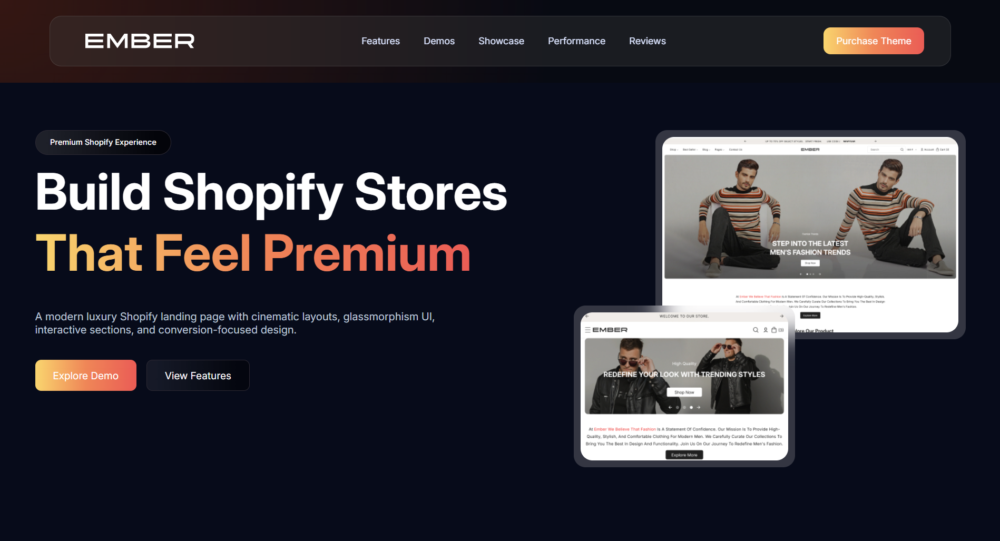
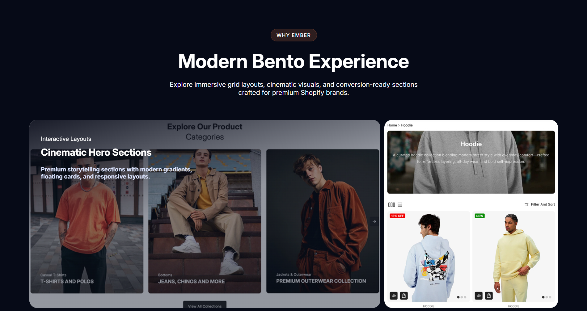
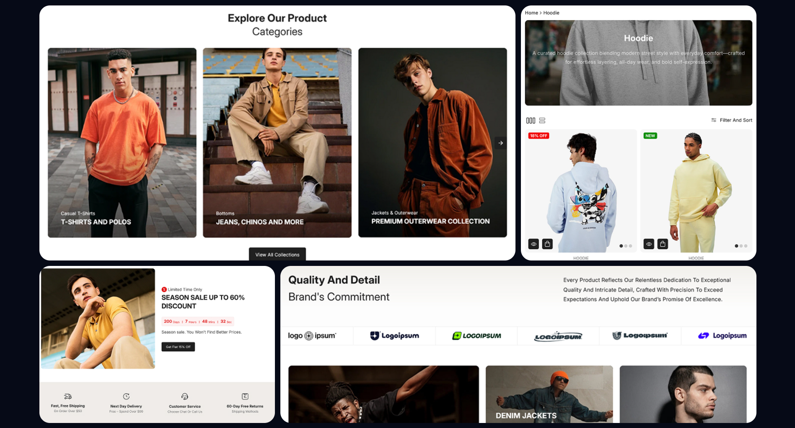
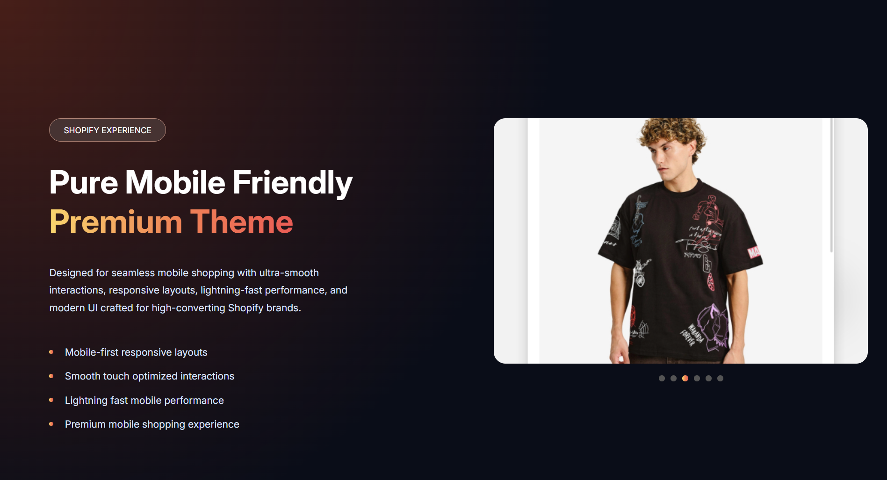
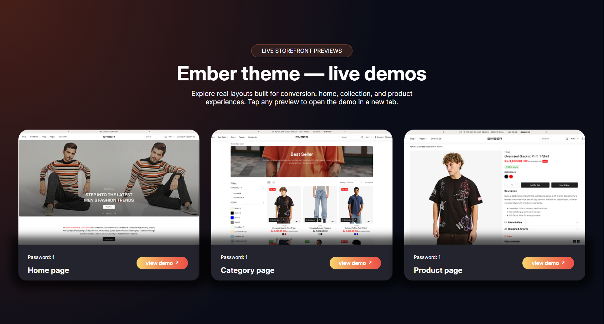
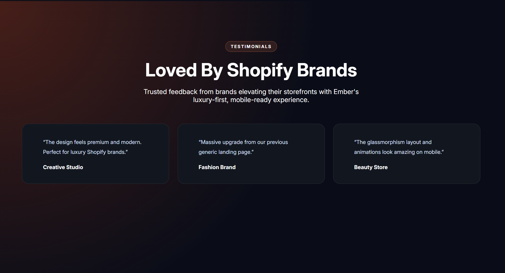
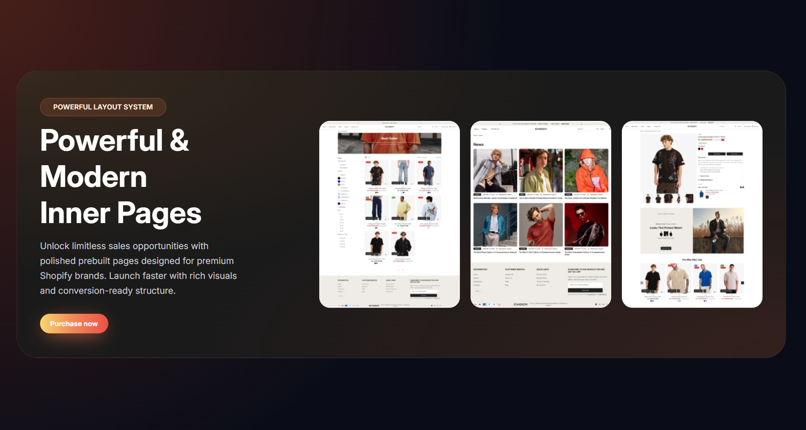
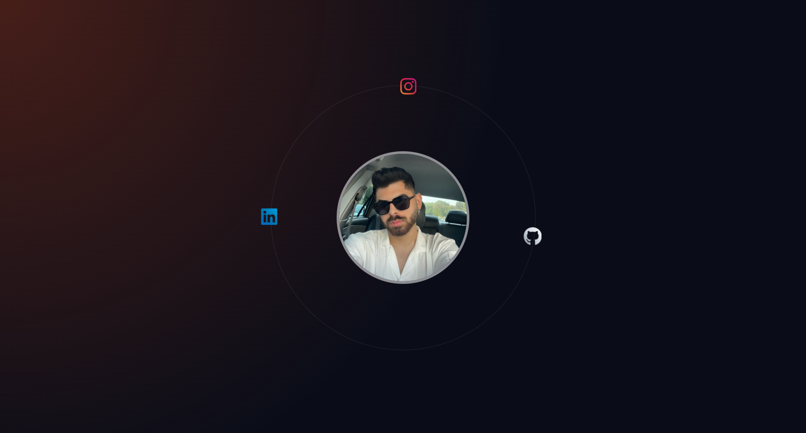

# 🔥 Ember | Luxury Shopify Landing Page

A modern, premium **Shopify theme landing page** built with **HTML5** and **CSS3** — featuring cinematic hero layouts, a bento-grid showcase, glassmorphism UI, live-demo cards, testimonials, and an animated orbit footer.

No JavaScript. No frameworks. No build step. Just clean, hand-written HTML & CSS. ✨

---

## 📑 Table of Contents

- [🖼️ Preview](#️-preview)
- [🔗 Demo](#-demo)
- [✨ Features](#-features)
- [🛠️ Tech Stack](#️-tech-stack)
- [📂 Project Structure](#-project-structure)
- [🚀 Getting Started](#-getting-started)
- [🌐 Deployment](#-deployment)
- [👤 Author](#-author)

---

## 🖼️ Preview

### 🎬 Hero

<p align="center">
  
</p>

### 🍱 Bento Experience

<p align="center">
  
</p>

<p align="center">
  
</p>

### 📱 Mobile-First Showcase

<p align="center">
  
</p>

### 🛍️ Live Demos

<p align="center">
  
</p>

### 💬 Testimonials

<p align="center">
  
</p>

### 📄 Inner Pages

<p align="center">
  
</p>

### 🌌 Orbit Footer

<p align="center">
  
</p>

---

## 🔗 Demo

👉 [**Live Demo**]((https://mohammadtakali.github.io/ember-shopify-landing-page/)
---

## ✨ Features

| # | Section | What it does |
|---|---------|--------------|
| 🧭 | **Header** | Logo, main navigation, and a gradient "Purchase Theme" call-to-action. |
| 🎬 | **Hero** | Bold headline with a gradient-highlighted keyword, two CTAs, and a desktop + mobile mockup pair. |
| 🍱 | **Bento Grid** | A modern asymmetric grid of cinematic cards with overlaid captions — *Why Ember*. |
| 📱 | **Mobile-First Showcase** | Feature list with gradient bullet dots next to a phone preview and slider dots. |
| 🛍️ | **Live Demo Cards** | Home, Category and Product page previews, each with a "view demo" link and password hint. |
| 💬 | **Testimonials** | Three quote cards from fashion, beauty and creative brands. |
| 📄 | **Inner Pages** | Showcase of prebuilt inner pages with a purchase CTA. |
| 🌌 | **Orbit Footer** | A circular profile photo with social icons orbiting around it, powered by `@keyframes`. |

**Extras**

- 🌈 Reusable orange gradient utility (`.orangegradient`) and gradient dot component (`.dot`)
- 🪟 Glassmorphism with `backdrop-filter: blur()`
- 🎯 Modern **CSS nesting** syntax
- 🔤 Variable font **Inter** (weights 100–900)
- 🧼 Clean global reset and helper classes in `public.css`

---

## 🛠️ Tech Stack

| Technology | Purpose |
|---|---|
| 🧱 **HTML5** | Semantic markup & page structure |
| 🎨 **CSS3** | Layout, gradients, glassmorphism, keyframe animations, nesting |
| 🔤 **Google Fonts** | `Inter` typography |
| 🧩 **Remix Icon** | UI icons (hosted locally) |
| 🔗 **Font Awesome 6** | Social icons in the footer (via CDN) |

---

## 📂 Project Structure

```text
ember-shopify-landing/
│
├── index.html                      # Main page
├── README.md
├── .gitignore
│
└── assets/
    ├── css/
    │   ├── public.css              # Global reset & utility classes
    │   └── master.css              # Section styles & animations
    │
    ├── icons/
    │   └── RemixIcon/              # Remix Icon CSS + font files
    │
    ├── preview/                    # README screenshots (preview1–8.png)
    │
    └── images/
        ├── logo/                   # logo.svg
        ├── section1/               # Hero mockups (sections.jpg, mobile.jpg)
        ├── section2/               # Bento grid cards (1–4.jpg)
        ├── section3/               # Mobile showcase (2.jpg)
        ├── section4/               # Demo previews (d1–d3.jpg)
        ├── section6/               # Inner pages (inner-page-1–3.jpg)
        └── footer/                 # Profile photo
```

---

## 🚀 Getting Started

No tools required — it's plain HTML & CSS.

**1. Clone the repository**

```bash
git clone https://github.com/<your-username>/<repo-name>.git
cd <repo-name>
```

**2. Open it**

Double-click `index.html`, or serve it locally (recommended):

```bash
npx serve .
# or
python3 -m http.server
```

> 💡 **Tip:** The CSS uses native nesting, so use an up-to-date browser (Chrome 120+, Edge 120+, Safari 17.2+, Firefox 117+).

---

## 🌐 Deployment

Deploy for free with **GitHub Pages**:

1. Push the project to GitHub.
2. Open **Settings → Pages**.
3. Under **Branch**, choose `main` and `/ (root)`, then click **Save**.
4. Your site goes live at `https://<your-username>.github.io/<repo-name>/` 🎉

---

## 👤 Author

**Mohammad Takali** — Front-end Developer

- 🐙 [GitHub](https://github.com/mohammadtakali)
- 💼 [LinkedIn](https://www.linkedin.com/in/mohammad-takali-b9b820434)
- 📸 [Instagram](https://instagram.com/mohammadtakali.dev)

---

<p align="center">Made with ❤️, HTML & CSS</p>
